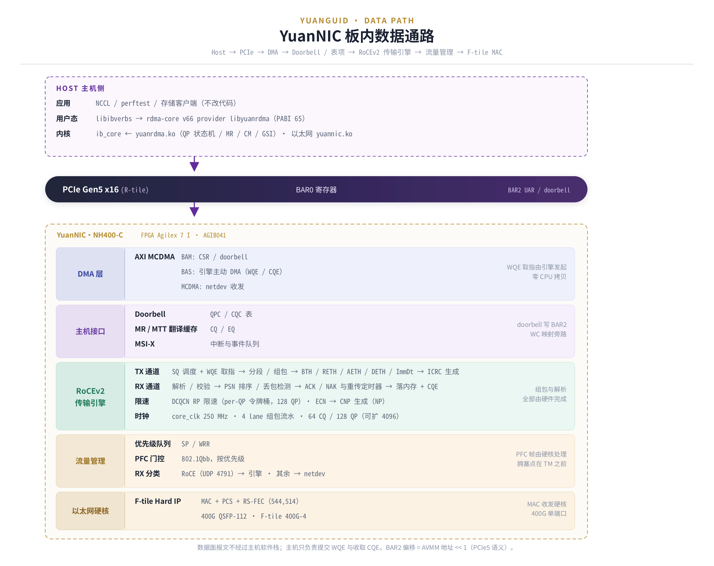
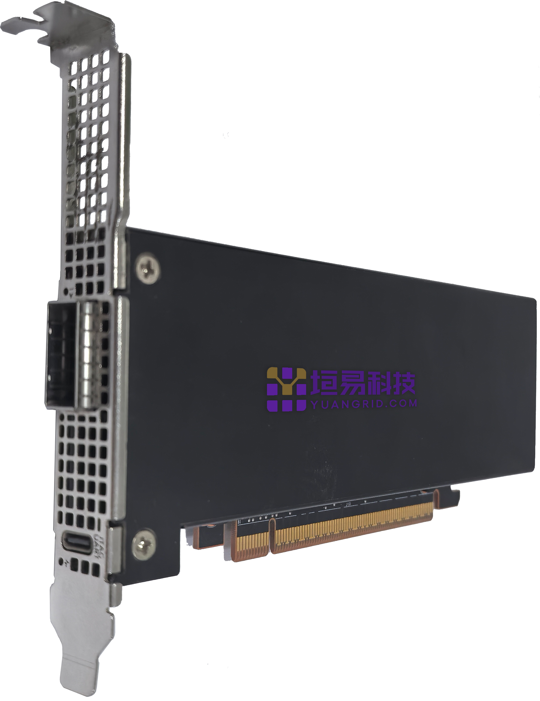

# YuanGrid / YuanRDMA

[简体中文](README.md) | English

<p align="center">
  
</p>

<p align="center">
  
  
  
  
  
</p>

<p align="center">
  
  
  
  
  
  
  
</p>

YuanRDMA is the FPGA-based 400G RoCEv2 RDMA SmartNIC from [YuanGrid](http://www.yuangrid.com), shipped as the **YuanNIC** product line. The RDMA transport engine is native to the FPGA, and the card presents itself to the host as a standard Ethernet NIC plus a standard RDMA device: ordinary Ethernet on the wire, standard `libibverbs` / `rdma-core` provider on the RDMA side, unmodified upstream perftest, and bidirectional interoperability with NVIDIA ConnectX-7 NICs on the same network.

The software stack covers two packet paths. On the **kernel path**, `yuannic.ko` registers the ports as Ethernet devices and `yuanrdma.ko` plugs into `ib_core`, so applications reach verbs through rdma-core. On the **user-space path**, `net_mcdma` is a DPDK poll-mode driver that moves packets directly from user space, bypassing the kernel — a better fit for high-throughput forwarding and protocol testing. Both paths share the same hardware queues and DMA channels and can coexist on one card.

At the hardware level YuanNIC brings link timing optimization and protocol offload to high-speed interconnect: wire-rate packet processing, ultra-low transport latency, 400G optical ports, programmable offload, PFC lossless networking and DCQCN congestion control. The 400G port can be configured as 1x400G / 1x200G / 1x100G / 1x40G, so one card serves both a full-speed spine and an existing slower network or test bench.

On the host side both **X86_64** and **ARM_64** are supported. RTL, firmware build, kernel drivers, the user-space provider and DPDK PMD, simulation and on-board test tooling form one complete hardware and software stack.

> This is the YuanNIC open-source project, releasing RTL, driver and tool sources under Apache-2.0.

## Contents

- [1 Ecosystem](#1-ecosystem)
- [2 Application Scenarios and Customers](#2-application-scenarios-and-customers)
- [3 Architecture](#3-architecture)
  - [3.1 On-card data path](#31-on-card-data-path)
  - [3.2 Communication control path](#32-communication-control-path)
- [4 Key Features](#4-key-features)
  - [4.1 RDMA line-rate transport](#41-rdma-line-rate-transport)
  - [4.2 DPDK line-rate forwarding](#42-dpdk-line-rate-forwarding)
  - [4.3 Intelligent acceleration](#43-intelligent-acceleration)
  - [4.4 Network security](#44-network-security)
  - [4.5 Continuous evolution](#45-continuous-evolution)
  - [4.6 Interfaces and software](#46-interfaces-and-software)
- [5 Resource Scale](#5-resource-scale)
- [6 Performance](#6-performance)
- [7 Supported Hardware](#7-supported-hardware)
- [8 Software Environment](#8-software-environment)
- [9 Quick Start](#9-quick-start)
- [10 Roadmap](#10-roadmap)
- [11 Contributing](#11-contributing)
- [12 License](#12-license)

## 1 Ecosystem

YuanRDMA is developed in the open, and we want it to grow through collaboration. Research institutes, universities, equipment vendors, AI computing centres and test/certification bodies are all in scope: where hardware is needed we provide cards and a test environment, and where realism is needed participants bring their own workloads and tune against them with us. Protocol extensions and validation of new mechanisms, congestion control and lossless-Ethernet tuning, driver and user-space stack improvements, interoperability testing and fault reproduction, documentation and teaching material are all worth investing in together — issues found, requirements raised and data produced all flow back into this open line of development.

Organisations and individuals interested in taking part are welcome to reach us by email at hfli@yuangrid.com, or by phone / WeChat on 18362630238.

## 2 Application Scenarios and Customers

1. **Operators building their own AI clusters → the interconnect layer of training and inference clusters → standard verbs plus programmable congestion control.** Multi-node communication in large-model training (AllReduce / AllGather / ReduceScatter) is bulk GPU-memory movement, and the variable that decides a cluster's effective compute. YuanNIC speaks standard verbs, so NCCL's built-in IB verbs plugin runs unmodified; multiple QPs in parallel push the transmit direction to 88% of line rate, while PFC lossless plus DCQCN hold collective bandwidth deterministic across a shared Ethernet fabric. Once a cluster passes a hundred GPUs, congestion parameters and retransmission behaviour have to follow its scale — programmability is what turns the network from an unpredictable bottleneck into a plannable extension of compute.

2. **Distributed and object storage vendors → NVMe-oF front ends and the data plane of KV / object stores → low latency plus MR capacity.** RDMA Read / Write bypass the kernel stack, with a single write at roughly 2.2 µs; 128 QPs and up to 512 MiB per MR carry NVMe-oF front ends and the data plane of distributed KV / object stores. Workloads that repeatedly write one large buffer to a remote node — KVCache offload, parameter servers — are exactly the shape Write with Immediate plus asynchronous completion was built for. The boundary between storage and compute is redrawn: remote memory costs almost as little to reach as local memory.

3. **Inference service providers → KV-cache transfer between nodes under prefill/decode disaggregation → direct GPU-memory access with no staging copies.** GPUDirect RDMA (dma-buf MR registration) carries data straight to GPU memory without staging through host memory, removing two copies when KV cache moves between nodes; IBGDA lets the GPU ring the doorbell itself, lifting the CPU off the submission path. Both are implemented, with on-board validation in progress — communication moving from "the CPU does it on our behalf" to "the device does it itself" is the precondition for inference clusters at ten-thousand-GPU scale.

4. **Network equipment and test-instrument vendors → a 400G peer NIC and interop test cases → fully configurable lossless-Ethernet parameters.** A single 400GbE port, per-priority PFC gating and register-configurable ECN + DCQCN let the card act as a switch's peer NIC under PFC / ECN and reproduce real behaviour, or stand in a 400G test instrument's port position; dropping to 200G / 100G / 40G plugs it into existing environments directly. In fabrics at hyperscale, stability comes down to the determinism of every parameter on the lossless path — and determinism can only be verified when those parameters can be read and changed.

5. **Research institutes and universities → a platform for protocol research and teaching → a fully open stack, with changes verified offline first.** RTL, drivers, provider and testbenches all live in this repository; changing a protocol field, a congestion algorithm or a retransmission policy means rebuilding firmware, with no NIC project to build from scratch. cocotb testbenches and the pre-build gate verify a change offline before it reaches hardware. The hardware stops being a black box fixed once and becomes a protocol carrier that keeps evolving — exactly what RDMA, congestion-control and FPGA networking research needs.

## 3 Architecture

### 3.1 On-card data path

Only WQE submission and CQE collection cross PCIe — data-plane packets enter and leave through the F-tile MAC and are assembled and parsed inside the engine, never touching the host software stack.



From the wire up: 400G QSFP-112 through the F-tile Ethernet Hard IP (MAC + PCS + RS-FEC); traffic management handles priority queues, the PFC gate and RX classification (RoCE UDP 4791 to the engine, everything else to netdev); the RoCEv2 transport engine does TX assembly and RX parsing, PSN and retransmission, ICRC generation and checking, and DCQCN's RP rate limiting and CNP generation; the host interface maintains the doorbell, QPC / CQC tables, MR / MTT translation cache and CQ / EQ; the DMA layer ties both sides together with AXI MCDMA's BAM (CSR / doorbell), BAS (engine-initiated WQE fetch and CQE write-back) and MCDMA (netdev). Port rate only affects the MAC and link-layer configuration — engine and software stack stay the same.

### 3.2 Communication control path

The full path of one RDMA operation, from application submission to usable data on the peer. Three control paths coexist and share the same verbs semantics and completion queue, so applications never distinguish them: regular verbs (the CPU builds and submits the WQE), IBGDA (the GPU rings the doorbell itself) and GPUDirect RDMA (data moves directly between GPU memory and the NIC, with no CPU staging).


1. The application calls `ibv_post_send`, builds a WQE in host memory, writes it to the SQ and rings the doorbell (BAR2 UAR page, WC-mapped).
2. The NIC DMA-fetches the WQE, checks `lkey / rkey` against the QPC and translates through the MTT to a physical address.
3. The engine assembles the packet — BTH / RETH / AETH / DETH + payload + ICRC — and admits it according to the PFC gate and the DCQCN token bucket.
4. The packet crosses the 400GbE link (or 200 / 100 / 40GbE); the peer orders it by PSN, writes the payload to memory and returns ACK / NAK in hardware; under congestion the switch marks ECN and the peer returns CNP.
5. On completion the NIC writes the CQE back to host memory; the application polls the CQ and returns the buffer by `wr_id`.
6. For RDMA Write the peer's memory is written by the NIC itself, with no peer CPU involvement; for Send the CQE is produced only after the NIC has written the payload into the RQ buffer.
7. With GPUs: after a `dma-buf` MR registration the data goes straight to device memory, and IBGDA lets the GPU ring the doorbell, taking the CPU off the submission path.

## 4 Key Features

### 4.1 RDMA line-rate transport

- **Native stack**: RoCEv2 RC / UD in RTL; assembly and parsing happen on the card, off the host software stack.
- **RC semantics**: Write / Write with Immediate / Read / Send / Send with Immediate; PSN, ACK / NAK, Go-back-N retransmission and timeouts, and ICRC all in hardware.
- **UD semantics**: Send / Send with Immediate (with DETH); the CQE reports the source QPN.
- **Multi-QP**: one QP is capped near 36% of line rate by per-packet assembly; 4 QPs reach 88% (352.1 Gb/s). `QP_NUM` defaults to 128, scalable to 4096.
- **Two connection setups**: RoCE CM (CM MADs over QP1 / GSI, the standard `rdma_cm` route), or TCP-based exchange (NCCL and perftest trade QP information over verbs, no CM needed).
- **QPN window**: QPNs sit in a base-aligned contiguous window; `FORCE_MAX_QP` / `FORCE_QPN_BASE` stay in sync between software and RTL.
- **PFC lossless**: per-priority transmit admission per IEEE 802.1Qbb, PFC frames handled by the F-tile hard MAC.
- **DCQCN**: full RP / NP / CNP across every QP, all parameters register-configurable.
- **Run-time tuning**: PFC priorities, DSCP, ECN thresholds, DCQCN rates and timers readable and writable online, no firmware rebuild.
- **Multi-rate port**: 1x400G / 1x200G / 1x100G / 1x40G selected by firmware build; the verbs interface and the software stack above it stay unchanged.

### 4.2 DPDK line-rate forwarding

- `net_mcdma` sends and receives straight from user space, cutting interrupts, context switches and memory copies.
- Queues map onto AXI MCDMA hardware queues with huge-page buffers, so 400GbE line-rate traffic can be taken up and rewritten.
- Shares the card with the RDMA path; forwarding, mirroring, protocol testing and impairment emulation each keep to their own stack.
- Built from repository source against DPDK 25.11.2.

### 4.3 Intelligent acceleration

- **Offload points**: MAC classification and timestamping, traffic-management shaping, RoCE assembly and retransmission, DMA movement and write-back all move to hardware as needed.
- **Protocol offload**: TCP / UDP / RoCEv2 assembly and parsing, ICRC checking and checksum in hardware.
- **Security offload**: crypto runs in the hardware pipeline, packets never land in host memory, keys and algorithms provisioned from the control plane.
- **Policy steering**: classify on five-tuple, DSCP, VLAN or custom fields and route to the RDMA engine, netdev, a DPDK queue or drop.
- **Congestion and reliability offload**: PFC gating, ECN marking, DCQCN rate limiting, loss detection and retransmission, independent of kernel timers.
- **Programmability**: protocol fields, congestion algorithms, retransmission policy and shaping parameters open at RTL and register level; a policy change is a firmware rebuild.
- **Visibility**: `rdmacli` for PFC / DSCP / ECN / DCQCN configuration, register and counter diagnostics and hang snapshots; `ynictrl` for NIC management.

### 4.4 Network security

YuanSec puts FPGA parallelism and DPDK forwarding behind one loop — receive, parse, detect, act — with inspection and cryptography moved off the host.

- **Line-rate parsing**: multi-field classification, timestamping and flow-table matching in hardware across 1 / 10 / 25 / 100 / 400 GE.
- **Fast forwarding**: multi-queue, zero-copy and load distribution; inspection and forwarding share one card, and a rule hit can drop, mirror or rewrite in user space.
- **Detection and audit**: anomaly detection, rule filtering and bypass analysis, with real-time blocking and a record of every hit.
- **Crypto and protocol offload**: national cryptographic algorithms, PQC, AES / RSA and dedicated protocol parsing and encapsulation in hardware, without packets returning to host memory.
- **Configurable policy**: match fields, actions and rule tables trimmed per workload, managed on the same surface as network policy.

Shipping forms include security gateways / firewalls, traffic-audit platforms, DDoS protection and scrubbing, and crypto-acceleration systems, covering government and enterprise, industrial control, data centres and high-speed communications.

### 4.5 Continuous evolution

- **Online firmware upgrade**: images are written to the configuration device over on-board Active Serial x4 (outputs `.sof` / `.rpd` / `.jic`). After the write the link re-enumerates and the drivers reload while the host OS keeps running — one script chains flash → re-enumerate → load drivers → configure network → self-check.
- **Version rollback**: images are identified by version (card model `YN400GA7B027A` / C) and multiple versions coexist, so rolling back is flashing the previous image. Upgrades touch only the configuration device and install nothing into the host system.
- **Layered upgrades**: firmware, kernel drivers (built against `uname -r`), and the user-space provider and PMD evolve separately, so changing one does not disturb the others; with parameters readable and writable at run time, tuning needs no firmware rebuild and upgrading needs no OS reinstall.
- **Diagnosable**: `rdmacli` and `ynictrl` read registers and counters and export hang snapshots; together with perftest, `roce_perf_test.sh` regression runs and hardware-side packet capture, a fault can be traced from symptom to register state instead of guessed at.
- **Interoperable with upper-layer software**: `rdma_cm`, NCCL and perftest keep their existing paths, while `rdmacli` / `ynictrl` and the control plane expose read and drive access upward, so monitoring and policy fit into existing operations tooling.
- **Verifiable changes**: RTL, drivers, provider and testbenches share one repository; a change to protocol fields, a congestion algorithm, retransmission policy or queue shaping runs the full chain from edit through offline validation (cocotb benches and the pre-build gate) to firmware and on-board regression.

### 4.6 Interfaces and software

- **Host interface**: PCIe Gen5 x16 (R-tile) + AXI MCDMA; doorbell, WQE fetch and CQE write-back are all hardware.
- **Kernel drivers**: `yuannic.ko` for netdev, `yuanrdma.ko` into `ib_core` for the RDMA device.
- **Provider**: `libyuanrdma` built from the same rdma-core v66 tree, isolated from the system DOCA stack.
- **PMD**: `net_mcdma` shares hardware queues with the kernel path, coexisting on one card.

## 5 Resource Scale

Queues, tables and memory translation are consolidated below; the figures follow parameterized configuration such as `QP_NUM` and can change with firmware.

<table width="100%" style="width:100% !important;display:table !important;table-layout:fixed">
<tr>
<td width="100%" valign="top">

<table width="100%" style="width:100% !important;display:table !important;table-layout:fixed">
<tr><th width="48%">Item</th><th width="52%">Specification</th></tr>
<tr><td width="48%">QPs</td><td width="52%">128 by default, scalable to 4096 (<code>QP_NUM</code>)</td></tr>
<tr><td width="48%">CQs</td><td width="52%">64</td></tr>
<tr><td width="48%">SQ / RQ depth</td><td width="52%">4096</td></tr>
<tr><td width="48%">CQ depth</td><td width="52%">up to 32768</td></tr>
<tr><td width="48%">Connection setup</td><td width="52%">CM MADs over QP1 / GSI</td></tr>
<tr><td width="48%">MTT entries</td><td width="52%">131072</td></tr>
<tr><td width="48%">Max per MR</td><td width="52%">512 MiB</td></tr>
<tr><td width="48%">Checking and translation</td><td width="52%"><code>lkey / rkey</code> checks and the address-translation cache in hardware</td></tr>
<tr><td width="48%">GPU memory access</td><td width="52%"><code>dma-buf</code> MR registration (<code>ibv_reg_dmabuf_mr</code>, kernel ≥ 6.2); software stack complete, on-board validation in progress</td></tr>
</table>

</td></tr>
</table>

## 6 Performance

Setup: YuanNIC-NH400-A, peer NVIDIA ConnectX-7, 400GbE direct link, upstream perftest, 1 MiB messages, 30 s per case.

<table width="100%" style="width:100% !important;display:table !important;table-layout:fixed">
<tr>
<td width="100%" valign="top">

<table width="100%" style="width:100% !important;display:table !important;table-layout:fixed">
<tr><th width="26%">Test</th><th width="37%">FPGA as client</th><th width="37%">FPGA as server</th></tr>
<tr><td width="26%"><code>ib_write_bw</code> (1 QP)</td><td width="37%">141.8 Gb/s (35.5%)</td><td width="37%">97.9 Gb/s (24.5%)</td></tr>
<tr><td width="26%"><code>ib_read_bw</code> (1 QP)</td><td width="37%">77.2 Gb/s (19.3%)</td><td width="37%">89.8 Gb/s (22.5%)</td></tr>
<tr><td width="26%"><code>ib_send_bw</code> (1 QP)</td><td width="37%">147.0 Gb/s (36.8%)</td><td width="37%">98.5 Gb/s (24.6%)</td></tr>
<tr><td width="26%"><code>ib_write_bw</code> (4 QP)</td><td width="37%"><strong>352.1 Gb/s (88.0%)</strong></td><td width="37%">—</td></tr>
<tr><td width="26%"><code>ib_read_bw</code> (4 QP)</td><td width="37%">—</td><td width="37%"><strong>328.2 Gb/s (82.1%)</strong></td></tr>
</table>

</td></tr>
</table>

Percentages are of the 400 Gb/s line rate. With 4 QPs the transmit direction reaches 88% of line rate and the receive direction 82%; a single QP is limited to about 36% by per-packet assembly overhead, which is the main reason to run multiple QPs in parallel. Latency (typical): `ib_write_lat` about **2.2 µs**; `ib_read_lat` / `ib_send_lat` about 2.7 µs.

## 7 Supported Hardware

<table width="100%" style="width:100% !important;display:table !important;table-layout:fixed">
<tr>
<td width="62%" valign="top">

<table width="100%" style="width:100% !important;display:table !important;table-layout:fixed">
<tr><th width="48%">Item</th><th width="52%">Specification</th></tr>
<tr><td width="48%">Model</td><td width="52%">YuanNIC-NH400-A</td></tr>
<tr><td width="48%">FPGA device</td><td width="52%">Agilex 7 I <code>AGIB027</code></td></tr>
<tr><td width="48%">Network port</td><td width="52%">1 × 400G QSFP-112 (F-tile 4x112)</td></tr>
<tr><td width="48%">Port modes</td><td width="52%">1x400G / 1x200G / 1x100G / 1x40G on the same cage, set by firmware</td></tr>
<tr><td width="48%">Host interface</td><td width="52%">PCIe Gen5 x16 (R-tile)</td></tr>
<tr><td width="48%">Core clock</td><td width="52%">RoCE engine at 250 MHz</td></tr>
<tr><td width="48%">Configuration</td><td width="52%">Active Serial x4</td></tr>
<tr><td width="48%">Card model</td><td width="52%"><code>YN400GA7B027A</code> / C</td></tr>
<tr><td width="48%">Form factor</td><td width="52%">Single slot, half-height half-length (with full-height bracket)</td></tr>
<tr><td width="48%">Dimensions</td><td width="52%">169.5 × 68.9 × 18.5 mm</td></tr>
<tr><td width="48%">Power</td><td width="52%">75 W max</td></tr>
<tr><td width="48%">Cooling</td><td width="52%">Passive heatsink, relies on chassis airflow</td></tr>
<tr><td width="48%">Operating temperature</td><td width="52%">0 – 55 ℃</td></tr>
</table>

</td>
<td width="38%" valign="middle" align="center">
  
</td>
</tr>
</table>

The port mode is chosen at firmware build time and takes effect after link negotiation; switching rate changes only MAC and link-layer configuration, leaving the verbs interface and the software stack untouched. Interoperability is validated against NVIDIA ConnectX-7. PCIe Gen5 x16 keeps the host-side bandwidth roughly at parity with 400GbE line rate, so the host interface does not become the first bottleneck.

## 8 Software Environment

<table width="100%" style="width:100% !important;display:table !important;table-layout:fixed">
<tr>
<td width="100%" valign="top">

<table width="100%" style="width:100% !important;display:table !important;table-layout:fixed">
<tr><th width="22%"><strong>Item</strong></th><th width="18%"><strong>Version</strong></th><th width="60%"><strong>Notes</strong></th></tr>
<tr><td width="22%">OS</td><td width="18%">Ubuntu 22.04, kernel <code>5.15.0-203-generic</code></td><td width="60%">X86_64 and ARM_64; on-board validation was done on X86_64, and driver vermagic must match <code>uname -r</code></td></tr>
<tr><td width="22%">Host architecture</td><td width="18%">X86_64, ARM_64</td><td width="60%">Drivers, provider, DPDK PMD and tooling all have build paths on both</td></tr>
<tr><td width="22%">RDMA user space</td><td width="18%">rdma-core v66 (built from this repository, PABI 65)</td><td width="60%">Provider is built against the same rdma-core tree; no stable external ABI, so it must be rebuilt per architecture</td></tr>
<tr><td width="22%">System RDMA stack</td><td width="18%">DOCA 3.5.0</td><td width="60%">Coexists in isolation, no uninstall needed</td></tr>
<tr><td width="22%">DPDK</td><td width="18%">25.11.2</td><td width="60%">User-space packet path, PMD <code>net_mcdma</code>; built with meson + ninja</td></tr>
<tr><td width="22%">CUDA</td><td width="18%">12.4</td><td width="60%">Only needed for NCCL / GPUDirect RDMA (T4 = sm_75, <code>NVCC_GENCODE=compute_75,sm_75</code>)</td></tr>
<tr><td width="22%">NCCL</td><td width="18%">2.22.3</td><td width="60%">Built from source; matches the 2.19.3–2.22.3 range validated against the reference product</td></tr>
<tr><td width="22%">nccl-tests</td><td width="18%">v2.21.1</td><td width="60%">Test suite matching the NCCL 2.21 / 2.22 API; two-node <code>all_reduce_perf</code></td></tr>
<tr><td width="22%">Simulator</td><td width="18%">Verilator 5.032</td><td width="60%">Must be built from source (the apt 4.038 lacks <code>--timing</code>); install to <code>/opt/verilator</code> and add to <code>PATH</code></td></tr>
<tr><td width="22%">Simulation framework</td><td width="18%">cocotb 1.9.2 · cocotb-bus 0.3.0 · cocotbext-axi 0.1.28</td><td width="60%">Testbenches target the cocotb 1.9 API; do not bump to 2.x casually</td></tr>
<tr><td width="22%">Python</td><td width="18%">3.10 (system default on Ubuntu 22.04)</td><td width="60%">Testbenches and packet-debug scripts</td></tr>
<tr><td width="22%">Compilers</td><td width="18%">gcc 11 / g++ 11</td><td width="60%">Ubuntu 22.04 default; the <code>5.15</code> kernel is built with it, so <code>code/kernel</code> builds with a plain <code>make</code></td></tr>
<tr><td width="22%">Build tools</td><td width="18%">cmake, meson, ninja, make, autoconf/flex/bison</td><td width="60%">cmake for the provider, meson + ninja for DPDK</td></tr>
<tr><td width="22%">FPGA toolchain</td><td width="18%">Quartus Prime Pro 26.1.1</td><td width="60%">Used only to produce firmware</td></tr>
</table>

</td></tr>
</table>

## 9 Quick Start

### 9.1 Prepare the environment

- Ubuntu 22.04 on an X86_64 or ARM_64 host; Quartus Prime Pro **26.1.1** (only needed to build firmware)
- Simulation needs Verilator 5.032 (built from source) and cocotb 1.9.2

### 9.2 Pre-build gate

```bash
test/sim/rtl_prebuild_gate.sh              # top-level wiring check + cocotb benches; non-zero on any failure
test/sim/rtl_prebuild_gate.sh --lint-only  # wiring check only (seconds)
```

### 9.3 Build the FPGA firmware

```bash
cd build/YuanNIC-NH400-A
./yuannic_build.sh <VER> <BUILD> <PORT_MODE> [all|boot|active]
./yuannic_build.sh 1 1 1X400G boot        # single 400G port
./yuannic_build.sh 2 1 1X200G active      # drop to 200G
```

`<PORT_MODE>` is one of `1X400G` / `1X200G` / `1X100G` / `1X40G`; outputs (`.sof` / `.rpd` / `.jic`) are archived by version under `build/firmware/`.

### 9.4 Flash, load drivers and test

```bash
./flash_and_init.sh --flash <image>        # flash → PCIe re-enumerate → load drivers → configure network → self-check
./flash_and_init.sh                        # no flashing; just bring drivers and network back up
ibv_devinfo -d yuanrdma0                   # expect PORT_ACTIVE
./roce_perf_test.sh --label <image>        # full bidirectional perftest suite against ConnectX-7
```

## 10 Roadmap

Done:

- [x] RoCEv2 RC engine, bidirectional perftest interop with ConnectX-7
- [x] Per-priority PFC gating
- [x] 128 QPs / 64 CQs / 131072 MTT entries; DCQCN across all 128 QPs
- [x] UD transport and RoCE CM (RTL and driver complete; simulation and unit tests pass)
- [x] 1x400G / 1x200G / 1x100G / 1x40G port modes, and a software stack on both X86_64 and ARM_64
- [x] GPUDirect RDMA and NCCL integration (software stack complete, on-board validation in progress)

In progress and beyond, along three tracks:

### 10.1 400G performance work and a collective communication library

A single QP reaches only 36% of line rate, limited by per-packet assembly overhead; multi-QP concurrency currently reaches 88%. The next step is to push the assembly and flow-control path toward line rate, and to consolidate multi-QP dispatch, congestion feedback and retransmission into reusable communication primitives. A collective communication library (AllReduce / AllGather / ReduceScatter) is built on top, so upper layers no longer manage QP parallelism themselves.

### 10.2 Broader workload coverage

Building on the validated GPUDirect RDMA and NCCL path, cover more real workload shapes: cross-node KV Cache transfer under prefill/decode disaggregation, the communication patterns of hybrid parallelism in training, and an interop matrix spanning multiple NIC and switch vendors.

### 10.3 800G (2027 target)

Architecture research and implementation for the next interconnect generation: timing closure at twice the link bandwidth, cache and scheduling overhead at larger QP scales, and the corresponding software stack.

## 11 Contributing

YuanRDMA aims to be an open, learnable and extensible RDMA NIC platform: RTL, drivers, provider, testbenches and test tooling all live in this repository, and a change can be verified offline before it reaches hardware. We want to lower the bar for high-performance networking research and engineering, so that questions about protocol mechanics, congestion control and transport reliability get answered on real 400G hardware rather than in simulation or on paper.

Organisations and individuals interested in taking part are welcome to reach us by email at [hfli@yuangrid.com](mailto:hfli@yuangrid.com), or by phone / WeChat on 18362630238.

Run `test/sim/rtl_prebuild_gate.sh` before committing; after any RTL change, at minimum run synthesis and timing analysis. Do not commit Quartus outputs (`qdb/`, `dni/`, `output_files/`). Documentation is primarily in Chinese with English technical terms.

## 12 License

Third-party open-source projects under `code/github/` follow their own licenses. RTL and reference designs derived from partners in the board projects are subject to their license terms, keep their original license headers, and are not redistributed. Everything else is copyright YuanGrid.
