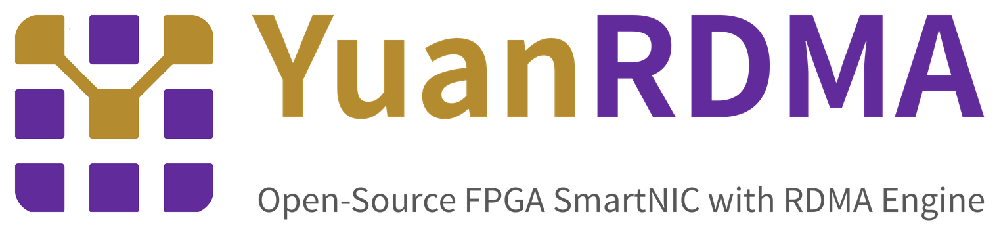
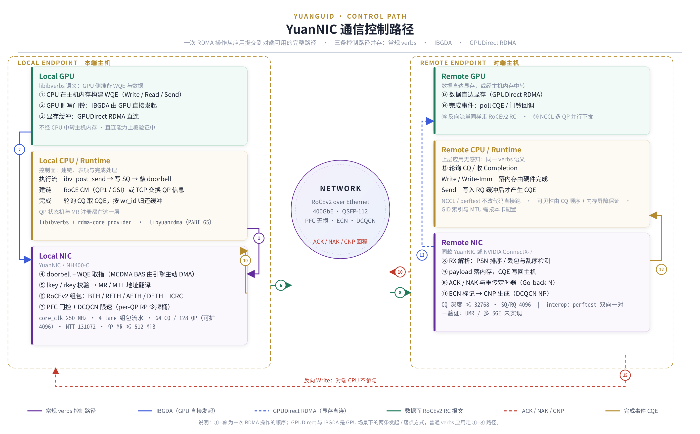

# YuanGrid / YuanRDMA

[简体中文](README.md) | English

<p align="center">
  
</p>

<p align="center">
  
  
  
  
  
</p>

<p align="center">
  
  
  
  
  
  
</p>

YuanRDMA is an FPGA-based 400G RoCEv2 RDMA SmartNIC developed by YuanGrid, shipped as the **YuanNIC** product line. The RDMA transport engine is built natively into the FPGA, and the card appears to the host as a standard RDMA device: it plugs in through the standard `libibverbs` / `rdma-core` provider model, runs unmodified upstream perftest, and interoperates bidirectionally with NVIDIA ConnectX-7 NICs on the same network. It targets AI clusters, high-speed interconnect, low-latency storage and intelligent offload workloads.

YuanNIC features hardware link timing optimization for high-speed interconnect and protocol offload, with wire-rate packet processing, ultra-low transport latency, 400G optical ports, programmable protocol offload, PFC lossless networking and DCQCN congestion control. The project covers the full hardware/software stack: RTL, firmware build, Linux kernel driver, user-space provider, simulation, and on-board test tooling.

> This is the YuanNIC open-source project, releasing RTL, driver and tool sources under Apache-2.0. Builds produce the FPGA firmware and user-space libraries for end users.

## Application Scenarios and Customers

1. **Operators building their own AI clusters → the interconnect layer of training and inference clusters → standard verbs plus programmable congestion control.** Multi-node communication in large-model training (AllReduce / AllGather / ReduceScatter) is ultimately bulk GPU-memory movement — and the variable that decides a cluster's effective compute. YuanNIC speaks standard verbs, so NCCL's built-in IB verbs plugin runs unmodified; running multiple QPs in parallel pushes the transmit direction to 88% of line rate, and PFC lossless plus DCQCN hold collective bandwidth deterministic across a shared Ethernet fabric. Once a cluster passes a hundred GPUs and communication takes an ever-larger share of iteration time, congestion-control parameters and retransmission behaviour have to follow its scale — and programmability is what turns the network from an unpredictable bottleneck into a plannable extension of compute.

2. **Distributed and object storage vendors → NVMe-oF front ends and the data plane of KV / object stores → low latency plus MR capacity.** RDMA Read / Write bypass the kernel stack, with a single write at roughly 2.2 µs. With 128 QPs and up to 512 MiB per MR, the card carries NVMe-oF front ends and the data plane of distributed KV / object stores. Workloads that repeatedly write one large buffer to a remote node — KVCache offload, parameter servers — are exactly the shape Write with Immediate plus asynchronous completion was built for. The boundary between storage and compute is redrawn: remote memory costs almost as little to reach as local memory.

3. **Inference service providers → KV-cache transfer between nodes in prefill/decode-disaggregated serving → direct GPU-memory access with no staging copies.** GPUDirect RDMA (dma-buf MR registration) carries data straight to GPU memory without staging through host memory, removing two copies when KV cache moves between nodes; IBGDA lets the GPU ring the doorbell itself, lifting the CPU off the submission path entirely. Both are implemented, with on-board validation in progress — communication moving from "the CPU does it on our behalf" to "the device does it itself" is the precondition for inference clusters at ten-thousand-GPU scale.

4. **Network equipment and test-instrument vendors → a 400G peer NIC and interop test cases → fully configurable lossless-Ethernet parameters.** A single 400GbE port, per-priority PFC gating and fully register-configurable ECN + DCQCN let the card serve as a switch's peer NIC under PFC / ECN and reproduce real behaviour, or stand in a test instrument's 400G port position. In fabrics at hyperscale, stability comes down to the determinism of every parameter on the lossless path — and determinism can only be verified when those parameters can be read and changed.

5. **Research institutes and universities → a platform for protocol research and teaching → a fully open hardware and software stack, with changes verified offline first.** RTL, drivers, provider and testbenches all live in this repository; changing a protocol field, a congestion-control algorithm or a retransmission policy means rebuilding firmware, with no NIC project to build from scratch. cocotb testbenches and the pre-build gate verify a change offline before it ever reaches hardware. The hardware stops being a black box fixed at tape-out and becomes a protocol carrier that keeps evolving — exactly what RDMA, congestion-control and FPGA networking research needs.

## Architecture

### On-card data path

Only WQE submission and CQE collection cross PCIe — data-plane packets enter and leave through the F-tile MAC and are assembled and parsed inside the engine, never touching the host software stack.


From the wire up: 400G QSFP-112 through the F-tile Ethernet Hard IP (MAC + PCS + RS-FEC); traffic management handles priority queues, the PFC gate and RX classification (RoCE UDP 4791 to the engine, everything else to netdev); the RoCEv2 transport engine does TX assembly and RX parsing, PSN and retransmission, ICRC generation/checking, and DCQCN's RP rate limiting and CNP generation; the host interface maintains the doorbell, QPC / CQC tables, MR / MTT translation cache and CQ / EQ; the DMA layer ties both sides together with AXI MCDMA's BAM (CSR / doorbell), BAS (engine-initiated WQE fetch and CQE write-back) and MCDMA (netdev).

### Communication control path

The full path of one RDMA operation, from application submission to usable data on the peer. Three control paths coexist: regular verbs (the CPU builds and submits the WQE), IBGDA (the GPU rings the doorbell itself) and GPUDirect RDMA (data moves directly between GPU memory and the NIC, with no CPU staging). Applications do not need to distinguish them — all three share the same verbs semantics and completion queue.



1. The application calls `ibv_post_send`, builds a WQE in host memory, writes it to the SQ and rings the doorbell (BAR2 UAR page, WC-mapped).
2. The NIC DMA-fetches the WQE, checks `lkey / rkey` against the QPC and translates through the MTT to a physical address.
3. The engine assembles the packet — BTH / RETH / AETH / DETH + payload + ICRC — and admits it according to the PFC gate and the DCQCN token bucket.
4. The packet crosses the 400GbE link; the peer orders it by PSN, writes the payload to memory and returns ACK / NAK in hardware; under congestion the switch marks ECN and the peer returns CNP.
5. On completion the NIC writes the CQE back to host memory; the application polls the CQ and returns the buffer by `wr_id`.
6. For RDMA Write the peer's memory is written by the NIC itself with no peer CPU involvement; for Send the CQE is produced only after the NIC has written the payload into the RQ buffer.
7. With GPUs: after a `dma-buf` MR registration the data goes straight to device memory, and IBGDA lets the GPU ring the doorbell, taking the CPU off the submission path.


## Key Features

**RDMA transport**

- QP setup: two ways to establish a connection — RoCE CM (the kernel driver exchanges CM MADs over the QP1 / GSI path, i.e. the standard `rdma_cm` route) and TCP-based out-of-band exchange (the path taken by NCCL and perftest, which trade QP information over verbs without CM).
- QP scale: 128 QPs by default, with `QP_NUM` parameterized up to 4096; QPNs live in a base-aligned contiguous window, and `FROCE_MAX_QP` / `FROCE_QPN_BASE` on the software side are kept in sync with the RTL.
- RoCEv2 RC: RDMA Write / Write with Immediate / Read / Send / Send with Immediate, with hardware PSN tracking, ACK/NAK, Go-back-N retransmission and timeout timers.
- RoCEv2 UD (Send / Send with Immediate with DETH); the CQE reports the source QPN.
- Hardware ICRC generation and checking.

**Resources**

- 128 QPs by default (expandable to 4096) and 64 CQs; SQ / RQ depth 4096; CQ depth up to 32768.
- 131072 MTT entries, up to 512 MiB per MR; hardware lkey / rkey checking with an address translation cache.
- GPUDirect RDMA: dma-buf MR registration (`ibv_reg_dmabuf_mr`, kernel ≥ 6.2, pending on-board validation).

**Lossless networking and congestion control**

- PFC (IEEE 802.1Qbb): per-priority transmit admission gating, with PFC frames handled by the F-tile hard MAC.
- DCQCN: full RP / NP / CNP implementation covering all QPs (128 today, scaling with `QP_NUM`), with every parameter register-configurable.

**Host interface and software stack**

- PCIe Gen5 x16 (Altera R-tile) + AXI MCDMA; doorbell, WQE fetch and CQE write-back are all done in hardware.
- Linux kernel driver `yuanrdma.ko` (on top of `ib_core`), Ethernet driver `yuannic.ko`.
- rdma-core v66 provider `libyuanrdma`, isolated from and coexisting with the system DOCA stack.
- DPDK PMD `net_mcdma` (based on DPDK 25.11.2).
- Operations tools: `rdmacli` (PFC / DSCP / ECN and DCQCN configuration, register and counter diagnostics, hang snapshots) and `nictrl` (NIC management).

## Performance

Setup: YuanNIC-NH400-A, peer NVIDIA ConnectX-7, 400GbE direct link, upstream perftest, 1 MiB messages, 30 s per case.

| Test | FPGA as client | FPGA as server |
|---|---|---|
| `ib_write_bw` (1 QP) | 141.8 Gb/s (35.5%) | 97.9 Gb/s (24.5%) |
| `ib_read_bw` (1 QP) | 77.2 Gb/s (19.3%) | 89.8 Gb/s (22.5%) |
| `ib_send_bw` (1 QP) | 147.0 Gb/s (36.8%) | 98.5 Gb/s (24.6%) |
| `ib_write_bw` (4 QP) | **352.1 Gb/s (88.0%)** | — |
| `ib_read_bw` (4 QP) | — | **328.2 Gb/s (82.1%)** |

Percentages are of the 400 Gb/s line rate. With 4 QPs the transmit direction reaches 88% of line rate and the receive direction 82%; a single QP is limited to about 36% by per-packet assembly overhead, which is the main reason to run multiple QPs in parallel.

Latency (typical): `ib_write_lat` about **2.2 µs**; `ib_read_lat` / `ib_send_lat` about 2.7 µs.

<table>
<tr>
<td valign="top">

<h2>Supported Hardware</h2>

<table width="100%">
<tr><td width="125"><b>Model</b></td><td>YuanNIC-NH400-A</td></tr>
<tr><td><b>FPGA device</b></td><td>Agilex 7 I <code>AGIB027</code></td></tr>
<tr><td><b>Network port</b></td><td>1 × 400G QSFP-112 (F-tile 4x112)</td></tr>
<tr><td><b>Host interface</b></td><td>PCIe Gen5 x16 (R-tile)</td></tr>
<tr><td><b>Configuration</b></td><td>Active Serial x4</td></tr>
<tr><td><b>Image prefix</b></td><td><code>YN400GA7B027A</code></td></tr>
<tr><td><b>Form factor</b></td><td>Single slot, half-height half-length (with full-height bracket)</td></tr>
<tr><td><b>Dimensions</b></td><td>169.5 × 68.9 × 18.5 mm</td></tr>
<tr><td><b>Power</b></td><td>75 W max</td></tr>
<tr><td><b>Cooling</b></td><td>Passive heatsink, relies on chassis airflow</td></tr>
<tr><td><b>Operating temperature</b></td><td>0 – 55 ℃</td></tr>
</table>

The RoCE engine core clock runs at 250 MHz. Interoperability is validated against NVIDIA ConnectX-7.

</td>
<td width="330" valign="middle" align="right"></td>
</tr>
</table>

### Software Environment

| Item | Version | Notes |
|---|---|---|
| OS | Ubuntu 22.04 x86_64, kernel `5.15.0` | The environment used for on-board validation; driver module vermagic must match `uname -r` |
| RDMA user space | rdma-core v66 (built from this repository, PABI 65) | Provider is built against the same rdma-core tree; there is no stable external ABI |
| System RDMA stack | DOCA 3.5.0 | Coexists in isolation, no uninstall needed; `env.sh` switches `LD_LIBRARY_PATH` |
| CUDA | 12.4 | Only needed for NCCL / GPUDirect RDMA (T4 = sm_75, `NVCC_GENCODE=compute_75,sm_75`) |
| NCCL | 2.22.3 | Built from source; matches the 2.19.3–2.22.3 range validated against the reference product |
| nccl-tests | v2.21.1 | Test suite matching the NCCL 2.21/2.22 API; two-node `all_reduce_perf` |
| Simulator | Verilator 5.032 | Must be built from source (the apt 4.038 lacks `--timing`); install to `/opt/verilator` and add to `PATH` |
| Simulation framework | cocotb 1.9.2 · cocotb-bus 0.3.0 · cocotbext-axi 0.1.28 | Testbenches target the cocotb 1.9 API; do not bump to 2.x casually |
| Python | 3.10 (system default on Ubuntu 22.04) | Testbenches and packet-debug scripts |
| Compilers | gcc 11 / g++ 11 | Ubuntu 22.04 default; the `5.15` kernel is built with it, so `code/kernel` builds with a plain `make` |
| Build tools | cmake, meson, ninja, make, autoconf/flex/bison | cmake for the provider, meson+ninja for DPDK |
| FPGA toolchain | Quartus Prime Pro 26.1.1 | Used only to produce firmware |

Dependency installation is covered under Quick Start below.

## Quick Start

### 1. Prepare the environment

- Ubuntu 22.04 x86_64; Quartus Prime Pro **26.1.1** (only needed to build firmware)
- Simulation needs Verilator 5.032 (built from source) and cocotb 1.9.2

### 2. Pre-build gate

```bash
test/sim/rtl_prebuild_gate.sh              # top-level wiring check + cocotb benches; non-zero on any failure
test/sim/rtl_prebuild_gate.sh --lint-only  # wiring check only (seconds)
```

### 3. Build the FPGA firmware

```bash
cd code/build/YuanNIC-NH400-A
./yuannic_build.sh <VER> <BUILD> 1X400G [all|base|release]
```

Outputs (`.sof` / `.rpd` / `.jic`) are archived by version under `code/build/firmware/`.

### 4. Build the user-space package

```bash
cd code/build/fpga_rdma
./yuannic_user_build.sh                    # rdma-core v66 + yuanrdma provider + perftest + kernel modules + tools
source YuanNIC_User_Package/env.sh         # run before each use; sets library and binary paths
```

The resulting `YuanNIC_User_Package/` (and its `.tgz`) can be handed directly to end users; nothing is installed into system paths.

### 5. Flash, load drivers and test

```bash
./flash_and_init.sh --flash <image>        # flash → PCIe re-enumerate → load drivers → configure network → self-check
./flash_and_init.sh                        # no flashing; just bring drivers and network back up
ibv_devinfo -d yuanrdma0                   # expect PORT_ACTIVE
./roce_perf_test.sh --label <image>        # full bidirectional perftest suite against ConnectX-7
```

## Roadmap

Done:

- [x] RoCEv2 RC engine, bidirectional perftest interop with ConnectX-7
- [x] Per-priority PFC gating
- [x] 128 QPs / 64 CQs / 131072 MTT entries; DCQCN across all 128 QPs
- [x] UD transport and RoCE CM (RTL and driver complete; simulation and unit tests pass)
- [x] GPUDirect RDMA and NCCL integration (software stack complete, on-board validation in progress)

In progress and beyond, along three tracks:

**1. 400G performance work and a collective communication library**

A single QP reaches only 36% of line rate, limited by per-packet assembly overhead; multi-QP concurrency currently reaches 88%. The next step is to push the assembly and flow-control path toward line rate, and to consolidate multi-QP dispatch, congestion feedback, and retransmission into reusable communication primitives. A collective communication library (AllReduce / AllGather / ReduceScatter) is built on top, so upper layers no longer manage QP parallelism themselves.

**2. Broader workload coverage**

Building on the validated GPUDirect RDMA and NCCL path, cover more real workload shapes: cross-node KV Cache transfer in disaggregated prefill/decode serving, the communication patterns of hybrid parallelism in training, and an interop matrix spanning multiple NIC and switch vendors.

**3. 800G (2027 target)**

Architecture research and implementation for the next interconnect generation, including timing closure at twice the link bandwidth, cache and scheduling overhead at larger QP scales, and the corresponding software stack.

## Contributing

- Run `test/sim/rtl_prebuild_gate.sh` before committing; after any RTL change, at least run synthesis and timing analysis.
- Do not commit Quartus outputs (`qdb/`, `dni/`, `output_files/`).
- Documentation is primarily in Chinese with English technical terms.

## License

Third-party open-source projects under `code/github/` are governed by their own licenses. RTL and reference designs derived from partners in the board projects are subject to their license terms, keep their original license headers, and are not redistributed. Everything else is copyright YuanGrid.
