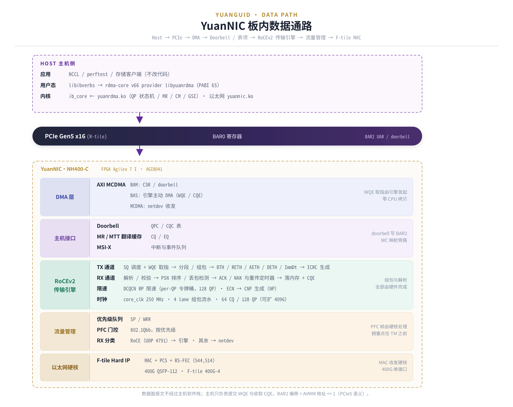
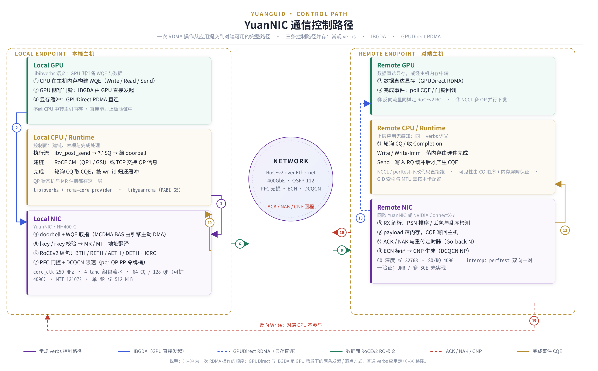
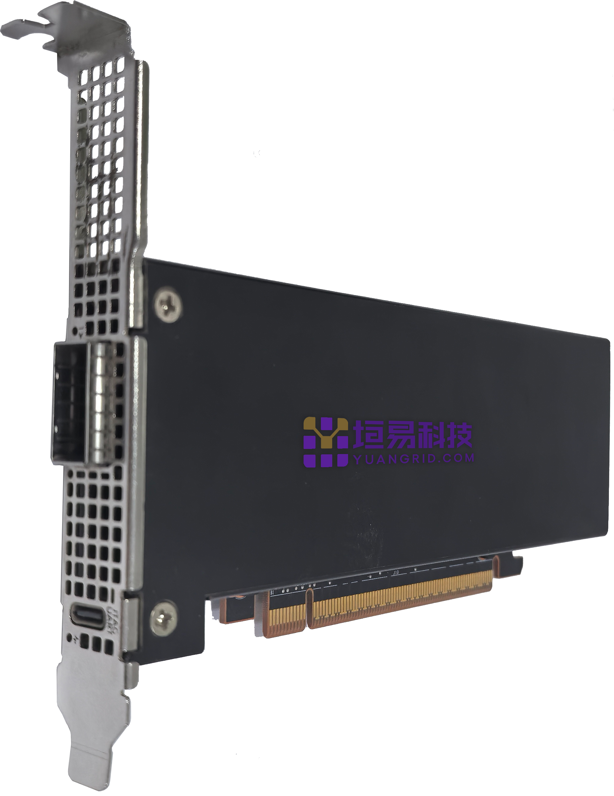

# 垣易科技 YuanGrid / YuanRDMA

简体中文 | [English](README.en.md)

<p align="center">
  
</p>

<p align="center">
  
  
  
  
  
</p>

<p align="center">
  
  
  
  
  
  
</p>

YuanRDMA 是[垣易科技](http://www.yuangrid.com)（[YuanGrid](http://www.yuangrid.com)）研发的基于 FPGA 的 400G RoCEv2 RDMA 智能网卡，产品型号为 **YuanNIC**。它在 FPGA 智能网卡中原生集成 RDMA 传输引擎，对主机呈现为一块标准以太网网卡和 RDMA 设备：网口侧走标准以太网协议栈，RDMA 侧通过标准 `libibverbs` / `rdma-core` provider 接入，原版 perftest 不改代码即可运行，并与 NVIDIA ConnectX-7 网卡在同一网络中双向互通，面向 AI 集群、高速互联、低时延存储与智能卸载等场景。

软件栈同时覆盖两种收包路径。**内核路径**下，`yuannic.ko` 把网口注册为标准以太网设备，`yuanrdma.ko` 接入 `ib_core`，应用经 rdma-core 直接使用 verbs；**用户态路径**下，`net_mcdma` 是 DPDK Poll Mode Driver，报文绕过内核直接在用户态收送，适合高吞吐转发与协议测试。两条路径共用同一套硬件队列与 DMA 通道，可按业务在同一块卡上并存。

在硬件层，YuanNIC 具备面向高速互联的链路时序优化与协议卸载能力，支持线速报文处理、超低传输时延、400G 高速光口、可编程协议卸载、PFC 无损网络与 DCQCN 拥塞控制。项目覆盖从 RTL、固件构建、内核驱动、用户态 provider 与 DPDK PMD，到仿真验证与上板测试工具链的完整软硬件栈。

> 本仓库是 YuanNIC 的开源工程，以 Apache-2.0 协议开放 RTL、驱动与工具源码。

## 目录

- [1 合作生态](#1-合作生态)
- [2 应用场景和主要客户](#2-应用场景和主要客户)
- [3 系统架构](#3-系统架构)
  - [3.1 板内数据通路](#31-板内数据通路)
  - [3.2 通信控制路径](#32-通信控制路径)
- [4 主要特性](#4-主要特性)
  - [4.1 RDMA 线速传输](#41-rdma-线速传输)
  - [4.2 DPDK 线速转发](#42-dpdk-线速转发)
  - [4.3 智能加速](#43-智能加速)
  - [4.4 网络安全](#44-网络安全)
  - [4.5 持续迭代](#45-持续迭代)
  - [4.6 接口软件](#46-接口软件)
- [5 资源规模](#5-资源规模)
  - [5.1 队列与表项](#51-队列与表项)
  - [5.2 内存翻译](#52-内存翻译)
  - [5.3 GPUDirect RDMA](#53-gpudirect-rdma)
- [6 性能](#6-性能)
- [7 支持的硬件](#7-支持的硬件)
  - [7.1 板卡规格](#71-板卡规格)
  - [7.2 接口与时钟](#72-接口与时钟)
- [8 软件环境](#8-软件环境)
- [9 快速开始](#9-快速开始)
  - [9.1 准备环境](#91-准备环境)
  - [9.2 编译前门禁](#92-编译前门禁)
  - [9.3 编译 FPGA 固件](#93-编译-fpga-固件)
  - [9.4 烧写、加载驱动与测试](#94-烧写加载驱动与测试)
- [10 路线图](#10-路线图)
  - [10.1 400G 性能优化与集合通信库](#101-400g-性能优化与集合通信库)
  - [10.2 扩大适配场景](#102-扩大适配场景)
  - [10.3 800G（2027 年目标）](#103-800g2027-年目标)
- [11 参与开发](#11-参与开发)
  - [11.1 提交约定](#111-提交约定)
- [12 许可证](#12-许可证)

## 1 合作生态

YuanRDMA 以开源方式推进，也希望以合作共建的方式生长。我们欢迎科研院所、高等院校、设备厂商、智算中心、测评机构等一起参与研发与测试：需要硬件时提供板卡与测试环境，需要场景时由参与方带来真实负载一起调优；协议扩展与新机制验证、拥塞控制与无损以太调优、驱动与用户态软件栈完善、互通性测试与故障复现、文档与教学材料的建设，都是可以共同投入的方向。发现的问题、提出的需求、跑出的数据，都会回到这条开源主线。

有意参与的单位或个人，欢迎通过邮件 hfli@yuangrid.com 或电话 / 微信 18362630238 与我们联系。

## 2 应用场景和主要客户

1. **自建智算集群的行业用户 → 训练与推理集群的互联层 → 标准 verbs 接口加可编程拥塞控制。** 大模型训练的多机通信（AllReduce / AllGather / ReduceScatter）本质上是 GPU 显存之间的大批量数据搬运，也是决定集群有效算力的关键变量。YuanNIC 走标准 verbs 接口，NCCL 自带的 IB verbs 插件零改造即可运行；多 QP 并行下发把 4 QP 的发送方向推到线速的 88%，配合 PFC 无损与 DCQCN 拥塞控制，在共享以太交换网上守住 collective 带宽的确定性。集群规模越过百卡、通信在迭代时间里的占比越来越大之后，拥塞控制参数与重传策略需要随规模调整，可编程性让网络从"不可控的瓶颈"变成"可规划的算力延伸"。

2. **分布式存储与对象存储厂商 → NVMe-oF 前端与 KV / 对象存储数据面 → 低时延加 MR 规格。** RDMA Read / Write 绕过内核协议栈，单次写时延约 2.2 µs；128 个 QP、单个 MR 最大 512 MiB 的规格，足以承载 NVMe-oF 前端与分布式 KV / 对象存储的数据面。KVCache 卸载、参数服务器这类"一块大 buffer 反复写远端"的负载，正是 Write with Immediate 加完成队列异步流水的最优形态。存储与计算的边界因此重划——远端内存的访问代价被压缩到接近本地。

3. **推理服务厂商 → P/D 分离架构下的 KV Cache 跨节点搬运 → 显存直连免去中转拷贝。** GPUDirect RDMA（dma-buf MR 注册）让数据不经主机内存中转直达显存，KV Cache 在节点间搬运时省掉两次拷贝；IBGDA 让 GPU 自己写门铃发起请求，把 CPU 从每次通信的提交路径上彻底摘除。两项均已实现，上板验证进行中——通信从"CPU 代劳"演进为"设备自主"，这正是万卡级推理集群的前置条件。

4. **网络通信设备厂商与测试仪表厂商 → 400G 对端网卡与互通用例 → 无损以太参数全可配。** 400GbE 单口、PFC 按优先级门控、ECN + DCQCN 全寄存器可配，既能作为交换机在 PFC / ECN 场景下的对端网卡复现真实行为，也能顶上测试仪表的 400G 端口位。超大规模智算网络的稳定性，最终取决于无损以太链路上每一个参数的确定性——参数可读可改，才谈得上验证这份确定性。

5. **科研院所与高校 → 协议研究与教学平台 → 软硬件栈全开源、改动可先离线验证。** RTL、驱动、provider、仿真台全部在本仓库，改协议字段、改拥塞控制算法、改重传策略都只需重编固件，不必从零搭建网卡工程；cocotb 仿真台与编译前门禁让改动能先离线验证再上板。硬件不再是一次性固化的黑盒，而是可持续演进的协议载体——面向 RDMA、拥塞控制与 FPGA 网络加速的研究，正需要这样一块随时可改的基座。

## 3 系统架构

### 3.1 板内数据通路

主机侧只有 WQE 提交与 CQE 收取穿过 PCIe，数据面报文从 F-tile MAC 进出、在引擎内完成组包与解析，不经过主机软件栈。



自下而上：400G QSFP-112 经 F-tile Ethernet Hard IP（MAC + PCS + RS-FEC）进出；流量管理做优先级队列、PFC 门控与 RX 分类（RoCE UDP 4791 走引擎，其余交 netdev）；RoCEv2 传输引擎负责 TX 组包与 RX 解析、PSN 与重传、ICRC 生成校验，以及 DCQCN 的 RP 限速与 CNP 生成；主机接口维护 doorbell、QPC / CQC 表、MR / MTT 翻译缓存与 CQ / EQ；DMA 层用 AXI MCDMA 的 BAM（CSR / doorbell）、BAS（引擎主动取 WQE、写 CQE）与 MCDMA（netdev）把两侧接起来。

### 3.2 通信控制路径

一次 RDMA 操作从应用提交到对端可用的完整路径如下。三条控制路径并存：常规 verbs（CPU 构建并提交 WQE）、IBGDA（GPU 自己写门铃发起）、GPUDirect RDMA（GPU 显存与网卡之间直接搬运，不经 CPU 中转）。应用侧不需要区分——三者共用同一套 verbs 语义和完成队列。



1. 应用调用 `ibv_post_send`，在主机内存构建 WQE，写入 SQ 并敲 doorbell（BAR2 UAR 页，WC 映射）。
2. 网卡 DMA 取 WQE，按 QPC 校验 `lkey / rkey`，经 MTT 翻译成物理地址。
3. 引擎组包：BTH / RETH / AETH / DETH + payload + ICRC，按 PFC 门控与 DCQCN 令牌桶放行。
4. 报文经 400GbE 发往对端；对端按 PSN 排序、落内存，硬件回 ACK / NAK；拥塞时交换机打 ECN，对端回 CNP。
5. 完成后网卡把 CQE 写回主机内存，应用轮询 CQ 取完成，按 `wr_id` 归还缓冲。
6. RDMA Write 的对端内存由网卡直接写，对端 CPU 不参与；Send 由网卡写入 RQ 缓冲后才产生 CQE。
7. GPU 场景：显存做 `dma-buf` MR 注册后，数据直达显存；IBGDA 则由 GPU 侧写门铃，把 CPU 从提交路径上摘掉。

## 4 主要特性

### 4.1 RDMA 线速传输

- **协议栈原生**：RoCEv2 RC / UD 在 RTL 中实现，组包与解析在网卡内完成，数据面不过主机软件栈。
- **RC 语义**：Write / Write with Immediate / Read / Send / Send with Immediate；PSN、ACK / NAK、Go-back-N 重传与超时、ICRC 全部硬件完成。
- **UD 语义**：Send / Send with Immediate（带 DETH），CQE 回报源 QPN。
- **多 QP 并行**：单 QP 受组包开销限制在线速 36%，4 QP 达 88%（352.1 Gb/s）；`QP_NUM` 默认 128，可扩至 4096。
- **建链两种**：RoCE CM（QP1 / GSI 交换 CM MAD，标准 `rdma_cm` 路径），或 TCP 交互建链信息（NCCL、perftest 经 verbs 自行交换，不依赖 CM）。
- **QPN 窗口**：QPN 落在基址对齐的连续窗口内，`FROCE_MAX_QP` / `FROCE_QPN_BASE` 软硬件同步。
- **PFC 无损**：IEEE 802.1Qbb 按优先级发送准入，PFC 帧由 F-tile 硬核 MAC 收发。
- **DCQCN**：RP / NP / CNP 完整实现，覆盖全部 QP，参数全寄存器可配。
- **在线可调**：PFC 优先级、DSCP、ECN 门限、DCQCN 速率与计时器在线读写，无需重编固件。

### 4.2 DPDK 线速转发

- `net_mcdma` 在用户态直接收送，不进内核协议栈，省掉中断、上下文切换与内存拷贝。
- 队列直连 AXI MCDMA 硬件队列，大页内存作缓冲，400GbE 线速报文可按需取用与改写。
- 与 RDMA 路径共用一块卡，转发、镜像、协议测试与损伤仿真各走各的软件栈。
- 基于 DPDK 25.11.2，随仓库源码构建。

### 4.3 智能加速

- **卸载点**：MAC 分类与时间戳、流量管理整形、RoCE 组包与重传、DMA 搬运与写回，均可下移硬件。
- **协议卸载**：TCP / UDP / RoCEv2 组包解析、ICRC 校验、checksum 计算由硬件完成。
- **安全卸载**：加解密在硬件流水线完成，报文不落主机内存，密钥与算法由配置面下发。
- **策略分流**：按五元组、DSCP、VLAN 或自定义字段分类，送 RDMA 引擎、netdev、DPDK 队列或丢弃。
- **拥塞与可靠性卸载**：PFC 门控、ECN 标记、DCQCN 限速、丢包检测与重传，不依赖内核定时器。
- **可编程**：协议字段、拥塞算法、重传策略、整形参数在 RTL 与寄存器层开放，改策略只重编固件。
- **可观测**：`rdmacli` 管 PFC / DSCP / ECN / DCQCN 参数与寄存器计数器、卡死快照；`nictrl` 管网卡管理。

### 4.4 网络安全

YuanSec 以 FPGA 并行计算加 DPDK 转发为数据面，把检测与密码运算搬到硬件，形成「收发 → 解析 → 检测 → 处置」闭环。

- **线速解析**：多维字段分类、时间戳与流表匹配硬件完成，覆盖 1 / 10 / 25 / 100 / 400 GE。
- **快速转发**：多队列、零拷贝与负载分发，检测面与转发面同卡，命中后可在用户态丢弃、镜像或改写。
- **检测与审计**：异常识别、规则过滤与旁路分析，实时拦截并留痕。
- **密码与协议卸载**：国密、PQC、AES / RSA 与专用协议解析封装在硬件完成，报文不回主机内存。
- **策略可配**：匹配字段、动作与规则表按业务裁剪，与网络策略同配置面管理。

交付形态包括安全网关 / 防火墙、流量审计平台、DDoS 防护清洗与密码加速系统，覆盖政企、工业控制、数据中心与高速通信。

### 4.5 持续迭代

- **固件在线升级**：镜像经板载 Active Serial x4 写入配置器件（产物 `.sof` / `.rpd` / `.jic`）；升级后 PCIe 重枚举、驱动重新加载，主机操作系统不重启，一条脚本串起烧写 → 重枚举 → 加载驱动 → 配网 → 自检。
- **版本可回退**：镜像以版本号标识（网卡型号 `YN400GA7B027A` / C），多版本并存，回退即烧回旧镜像；升级只动配置器件，不向主机系统安装任何文件。
- **分层独立升级**：固件、内核驱动（随 `uname -r` 编译）、用户态 provider 与 PMD 各自独立演进，改一层不必动另两层；加上参数在线读写，调参不重编固件、升级不重装系统。
- **问题可定位**：`rdmacli` 与 `nictrl` 读取寄存器与计数器、导出卡死现场快照，配合 perftest、`roce_perf_test.sh` 回归与硬件侧镜像抓包，故障可从现象追到寄存器状态，不必靠猜。
- **与上层软件联动**：对内保持 `rdma_cm`、NCCL 与 perftest 的既有路径，对外经 `rdmacli` / `nictrl` 与配置面向上层软件开放读写与操控，监控与策略可纳入既有运维体系。
- **改动可验证**：RTL、驱动、provider、仿真台同仓，协议字段、拥塞算法、重传策略与队列整形的改动，从改代码、离线验证（cocotb 仿真台与编译前门禁）、出固件到上板回归是一条完整链路。

### 4.6 接口软件

- **主机接口**：PCIe Gen5 x16（R-tile）+ AXI MCDMA，doorbell、WQE 取指与 CQE 写回全硬件完成。
- **内核驱动**：`yuannic.ko` 提供 netdev，`yuanrdma.ko` 接入 `ib_core` 提供 RDMA 设备。
- **provider**：`libyuanrdma` 与 rdma-core v66 同源编译，与系统 DOCA 栈隔离共存。
- **PMD**：`net_mcdma` 与内核路径共用硬件队列，可在同一块卡上并存。

## 5 资源规模

### 5.1 队列与表项

| 项 | 规格 |
|---|---|
| QP 数量 | 默认 128，可扩展至 4096（`QP_NUM` 参数化） |
| CQ 数量 | 64 |
| SQ / RQ 深度 | 4096 |
| CQ 深度 | 最高 32768 |
| 建链资源 | QP1 / GSI 承载 CM MAD |

### 5.2 内存翻译

| 项 | 规格 |
|---|---|
| MTT 表项 | 131072 |
| 单个 MR 上限 | 512 MiB |
| 校验与翻译 | lkey / rkey 校验、地址翻译缓存在硬件完成 |

### 5.3 GPUDirect RDMA

- 支持 dma-buf MR 注册（`ibv_reg_dmabuf_mr`，内核 ≥ 6.2），数据直达显存，不经主机内存中转。
- 状态：软件栈已完成，上板验证进行中。

## 6 性能

测试条件：YuanNIC-NH400-A，对端 NVIDIA ConnectX-7，400GbE 直连，原版 perftest，消息 1 MiB、每项 30 s。

| 用例 | FPGA 作客户端 | FPGA 作服务端 |
|---|---|---|
| `ib_write_bw`（1 QP） | 141.8 Gb/s（35.5%） | 97.9 Gb/s（24.5%） |
| `ib_read_bw`（1 QP） | 77.2 Gb/s（19.3%） | 89.8 Gb/s（22.5%） |
| `ib_send_bw`（1 QP） | 147.0 Gb/s（36.8%） | 98.5 Gb/s（24.6%） |
| `ib_write_bw`（4 QP） | **352.1 Gb/s（88.0%）** | — |
| `ib_read_bw`（4 QP） | — | **328.2 Gb/s（82.1%）** |

括号内为占总带宽（400 Gb/s 线速）的百分比。多 QP 并发时发送方向达到线速的 88%、接收方向 82%；单 QP 受每包组包开销限制，约 36%，这也是需要多 QP 并行下发的原因。

时延（typical）：`ib_write_lat` 约 **2.2 µs**，`ib_read_lat` / `ib_send_lat` 约 2.7 µs。

## 7 支持的硬件

### 7.1 板卡规格

<table width="100%">
<tr>
<td width="62%" valign="top">

| 项 | 规格 |
|---|---|
| 型号 | YuanNIC-NH400-A |
| FPGA 器件 | Agilex 7 I `AGIB027` |
| 网口 | 1 × 400G QSFP-112（F-tile 4x112） |
| 主机接口 | PCIe Gen5 x16（R-tile） |
| 配置方式 | Active Serial x4 |
| 网卡型号 | `YN400GA7B027A` / C |
| 形态 | 单槽半高半长（配全高挡片） |
| 尺寸 | 169.5 × 68.9 × 18.5 mm |
| 功耗 | 最大 75 W |
| 散热 | 被动散热，依赖机箱风道 |
| 工作温度 | 0 – 55 ℃ |

</td>
<td width="38%" valign="middle" align="center">
  
</td>
</tr>
</table>

### 7.2 接口与时钟

- RoCE 引擎核心时钟 250 MHz。
- 对端互通验证使用 NVIDIA ConnectX-7。

## 8 软件环境

| 项 | 版本 | 说明 |
|---|---|---|
| 操作系统 | Ubuntu 22.04 x86_64，内核 `5.15.0` | 上板验证所用环境；驱动模块 vermagic 须与 `uname -r` 一致 |
| RDMA 用户态 | rdma-core v66（随本仓库编译，PABI 65） | provider 与 rdma-core 同源编译，无稳定外部 ABI |
| 系统 RDMA 栈 | DOCA 3.5.0 | 与本栈隔离共存，无需卸载 |
| DPDK | 25.11.2 | 用户态收包路径，PMD 为 `net_mcdma`；需 meson + ninja 构建 |
| CUDA | 12.4 | 仅 NCCL / GPUDirect RDMA 场景需要（T4 = sm_75，`NVCC_GENCODE=compute_75,sm_75`） |
| NCCL | 2.22.3 | 源码编译，与对标产品验证过的 2.19.3–2.22.3 区间对齐 |
| nccl-tests | v2.21.1 | NCCL 2.21/2.22 API 的对应测试集，`all_reduce_perf` 双机 |
| 仿真器 | Verilator 5.032 | 需源码编译（apt 的 4.038 不支持 `--timing`），装到 `/opt/verilator` 并加入 `PATH` |
| 仿真框架 | cocotb 1.9.2 · cocotb-bus 0.3.0 · cocotbext-axi 0.1.28 | 台子按 cocotb 1.9 API 编写，不可随手升 2.x |
| Python | 3.10（Ubuntu 22.04 系统自带） | 仿真台子与报文调试脚本 |
| 编译器 | gcc 11 / g++ 11 | Ubuntu 22.04 默认版本，`5.15` 内核用它编译，`code/kernel` 直接 `make` 即可 |
| 构建工具 | cmake、meson、ninja、make、autoconf/flex/bison | provider 用 cmake，DPDK 用 meson+ninja |
| FPGA 工具链 | Quartus Prime Pro 26.1.1 | 仅用于出固件 |

## 9 快速开始

### 9.1 准备环境

- Ubuntu 22.04 x86_64，Quartus Prime Pro **26.1.1**（仅编译固件需要）
- 仿真需 Verilator 5.032（源码编译）与 cocotb 1.9.2

### 9.2 编译前门禁

```bash
test/sim/rtl_prebuild_gate.sh              # 顶层连线检查 + cocotb 仿真台，任一失败返回非 0
test/sim/rtl_prebuild_gate.sh --lint-only  # 只跑连线检查（秒级）
```

### 9.3 编译 FPGA 固件

```bash
cd code/build/YuanNIC-NH400-A
./yuannic_build.sh <VER> <BUILD> 1X400G [all|base|release]
```

产物（`.sof` / `.rpd` / `.jic`）按版本号归档到 `code/build/firmware/`。

### 9.4 烧写、加载驱动与测试

```bash
./flash_and_init.sh --flash <镜像版本>     # 烧写固件 → PCIe 重枚举 → 加载驱动 → 配网 → 自检
./flash_and_init.sh                        # 不烧写，只重新拉起驱动与网络
ibv_devinfo -d yuanrdma0                   # 应看到 PORT_ACTIVE
./roce_perf_test.sh --label <镜像版本>     # 与 ConnectX-7 双向跑全套 perftest
```

## 10 路线图

已完成：

- [x] RoCEv2 RC 引擎，与 ConnectX-7 双向 perftest 互通
- [x] PFC 按优先级门控
- [x] QP 128 / CQ 64 / MTT 131072，DCQCN 覆盖 128 QP
- [x] UD 传输、RoCE CM（RTL 与驱动完成，仿真与单测通过）
- [x] GPUDirect RDMA 与 NCCL 接入（软件栈完成，上板验证进行中）

进行中与后续，三条主线：

### 10.1 400G 性能优化与集合通信库

单 QP 受每包组包开销限制只跑到线速的 36%，多 QP 并发目前 88%。下一步是优化组包与流控路径向线速逼近，并把多 QP 下发的调度、拥塞反馈与重传收敛成可复用的通信原语，在其上构建面向集合通信（AllReduce / AllGather / ReduceScatter）的通信库，让上层无需自己管理 QP 并行度。

### 10.2 扩大适配场景

在已验证的 GPUDirect RDMA 与 NCCL 基础上，覆盖更多实际负载形态：P/D 分离推理中的 KV Cache 跨节点搬运、训练侧的混合并行通信模式、以及多厂商网卡与交换机的互通矩阵。

### 10.3 800G（2027 年目标）

面向下一代互联的架构预研与实现，包括链路层带宽翻倍的时序收敛、更大 QP 规模下的缓存与调度开销，以及配套软件栈的适配。

## 11 参与开发

YuanRDMA 旨在成为可开源、可学习、可扩展的 RDMA 网卡平台：RTL、驱动、provider、仿真台与测试工具全部在仓库内，改动可以离线验证再上板。我们希望降低高性能网络的研究与工程门槛，让协议机制、拥塞控制、传输可靠性这些问题能在真实的 400G 硬件上被验证，而不是停留在仿真或纸面。

有意参与的单位或个人，欢迎通过邮件 [hfli@yuangrid.com](mailto:hfli@yuangrid.com) 或电话 / 微信 18362630238 与我们联系。

### 11.1 提交约定

- 提交前跑 `test/sim/rtl_prebuild_gate.sh`；RTL 修改后至少完成综合与时序分析。
- 不提交 Quartus 生成物（`qdb/`、`dni/`、`output_files/`）。
- 文档以中文为主，技术名词保留英文。

## 12 许可证

`code/github/` 下的第三方开源项目遵循各自的许可证。板卡工程中源自合作方的 RTL 与参考设计受授权约束，保留原有 license 头，不对外分发。其余部分版权归垣易科技（YuanGrid）所有。
